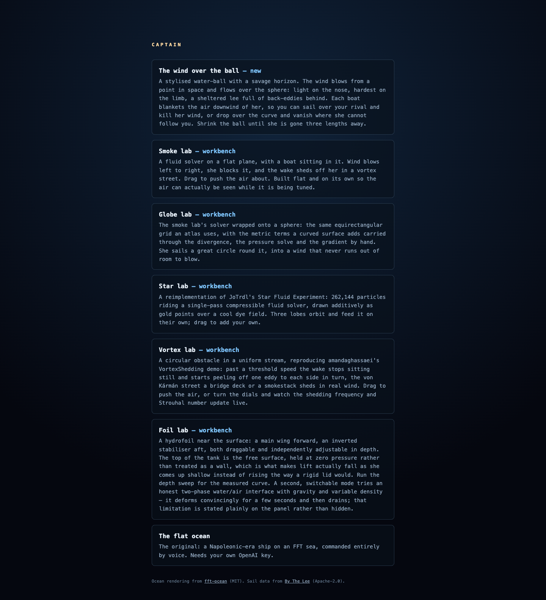
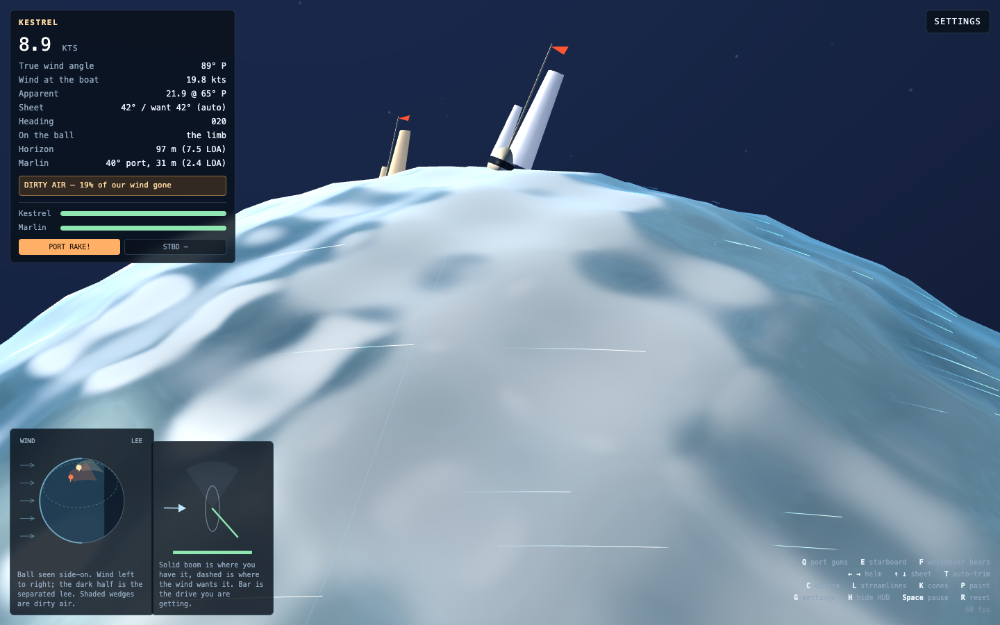
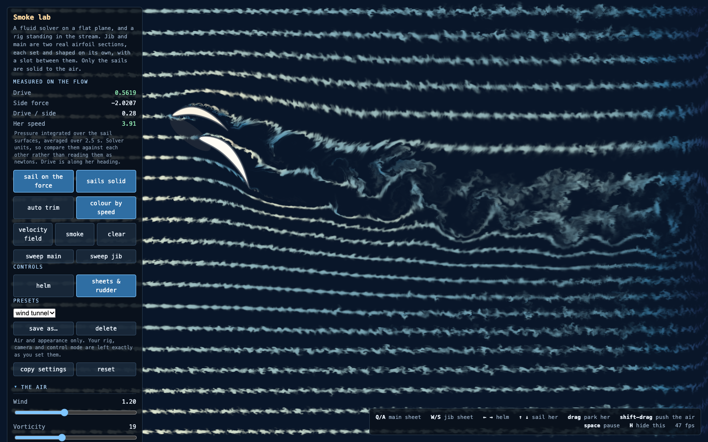
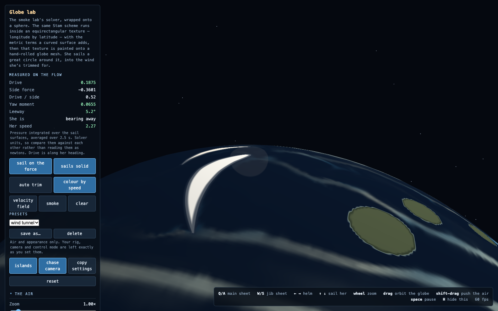
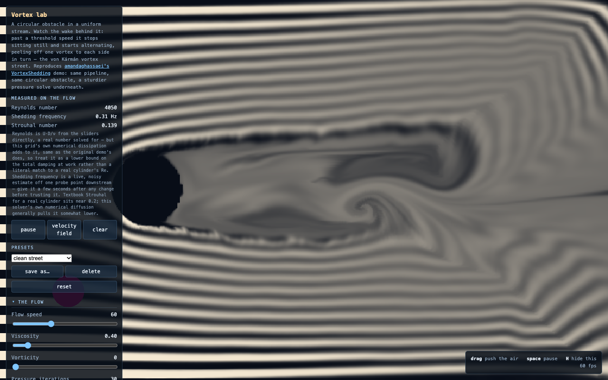
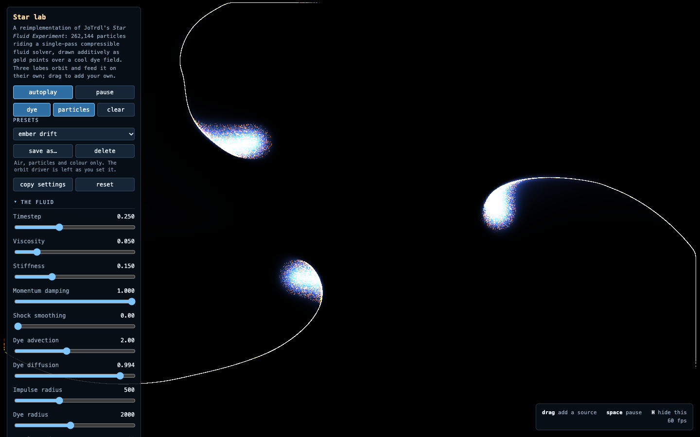
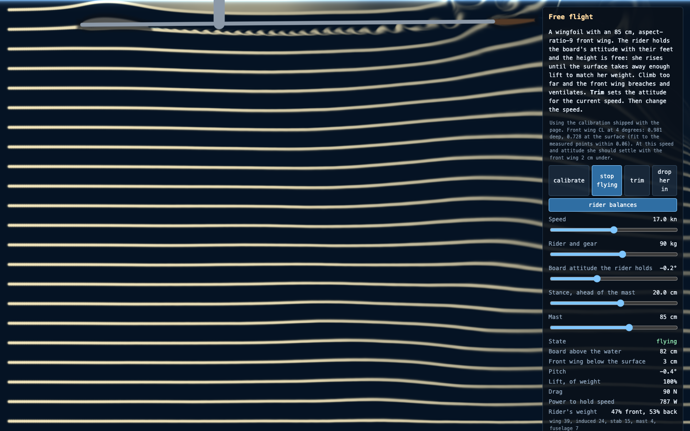
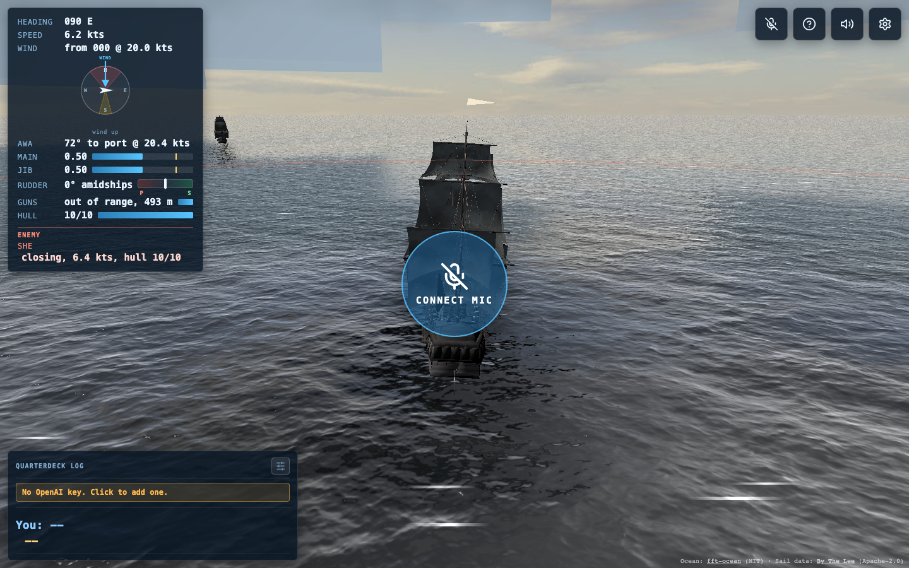

# Captain

Sailing simulations that run in the browser. Play them at
**https://mattarderne.github.io/captain-demo/**, where the front page lists every one.

Every page is static HTML and raw WebGL, with no build step and no server. Only the voice game
needs a key.

## The wind over the ball

[Play](https://mattarderne.github.io/captain-demo/planet/) · [source](planet/) · [how it works](planet/README.md)

Two boats race on a small water-ball whose horizon sits a few boat lengths away. The wind blows
from a point in space and flows over the sphere. It is light on the nose, hardest on the limb and
confused in the lee. Each boat blankets the air downwind of her, so you can sail over a rival and
take her wind, or drop over the curve and vanish. Both boats carry guns.

## Smoke lab

[Play](https://mattarderne.github.io/captain-demo/smoke-lab/) · [source](smoke-lab/)

A fluid solver on a flat plane with a two-sail rig standing in the stream. The jib and main are
real airfoil sections pinned at the stemhead and the mast, with a slot between them. Drive and
side force are measured from the pressure around the sails, so a change of trim shows up in the
numbers without any lift model behind it. The smoke only shows the flow. Drag to push the air
about.

## Globe lab

[Play](https://mattarderne.github.io/captain-demo/globelab/) · [source](globelab/)

The smoke lab's solver wrapped onto a sphere. The boat sails great circles and crosses the poles
without a hitch. She has a keel, so she slips sideways until it grips, and she steers by the
balance of her sails alone. Load the jib and she bears away. Sheet the main in hard and she rounds
up. Find the trim where the two cancel and she holds her course by herself. Islands stand in the
wind.

## Vortex lab

[Play](https://mattarderne.github.io/captain-demo/vortex-lab/) · [source](vortex-lab/)

A circular obstacle in a steady stream, rebuilt from Amanda Ghassaei's
[VortexShedding](https://github.com/amandaghassaei/VortexShedding). Past a threshold speed the wake
starts peeling off eddies to alternate sides and forms a von Kármán vortex street. The panel
measures the Reynolds number, the shedding frequency and the Strouhal number as it runs.

## Star lab

[Play](https://mattarderne.github.io/captain-demo/star-lab/) · [source](star-lab/)

A rebuild of JoTrdl's [Star Fluid Experiment](https://github.com/JoTrdl/starfluid). It carries
262,144 particles on a compressible fluid solver and draws them as points of light over a dye
field. Three sources orbit and stir it. Drag to add your own.

## Foil lab

[Play](https://mattarderne.github.io/captain-demo/foil-lab/) · [source](foil-lab/)

A hydrofoil in a tank of moving water. The main wing sits forward and an inverted stabiliser aft,
each at its own depth, and you can drag the pair anywhere. The water surface is held at zero
pressure, so lift falls away as the foil comes up shallow, as it does on a real foil at speed. The
depth and offset sweeps record the lift curve. A second mode tries a full two-phase water and air
surface. It deforms convincingly for a few seconds and then drains, and the panel says so.

**Free flight** puts a wingfoil in the tank: an 85 cm front wing at aspect ratio 9, a stabiliser
and a mast. The solver measures the rig's lift and pitching moment over a grid of depths and pitch
angles, and the board then flies in real time on those numbers while the rider holds its attitude.
She rises until the surface takes away enough lift to match her weight, and the drag falls as the
mast comes out of the water. Go too fast and the front wing breaches and ventilates.

## Voice-controlled sailing

[Play](https://mattarderne.github.io/captain-demo/fft-ocean/) · [source](fft-ocean/)

A Napoleonic-era sailing game you command by voice. Hold **Space** or the Hold-to-Talk button and
give an order, such as "helm a-starboard twenty degrees", "ease the main sheet" or "how are we
doing". The crew answers in character, and the ship responds through a real sailing model with
apparent wind, leeway, a no-go zone and keel bite.

To play, open the page and paste your own OpenAI API key when asked. It stays in your browser's
localStorage and is sent only to api.openai.com. This site has no server and collects nothing. Then
press V for the quarterdeck helm view, S for settings, or Run Demo to watch her tack herself.

## Credits

Ocean rendering from [fft-ocean](https://github.com/jbouny/fft-ocean) (MIT). Sail lift and drag
data from [By The Lee](https://github.com/leeboardtools/bythelee) (Apache-2.0). The vortex lab
follows Amanda Ghassaei's [VortexShedding](https://github.com/amandaghassaei/VortexShedding) and
the star lab follows JoTrdl's [starfluid](https://github.com/JoTrdl/starfluid) (MIT). The voice
game uses OpenAI transcription and tool calling.
